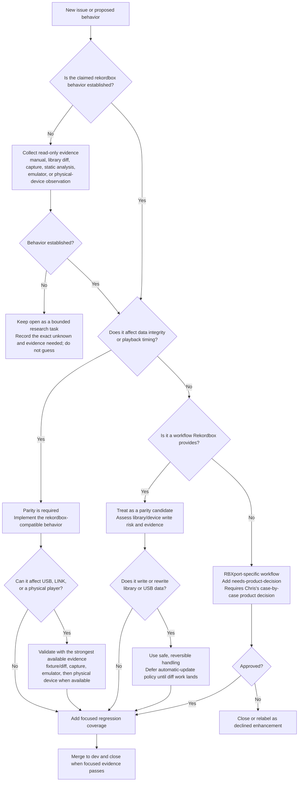

# Rekordbox parity decision flow

This is the current decision policy for backlog triage and implementation.
It records product direction from the October 2026 backlog review; it is not
evidence that a particular rekordbox behavior exists. Establish that behavior
first using the evidence conventions below.

## Rules behind the flow

1. **Data integrity and playback timing come first.** An export must not
   knowingly crash, corrupt, or destabilize a player. Link behavior must not
   knowingly cause player misbehavior.
2. **Match Rekordbox quirks when evidence supports them.** The goal is
   best-effort compatibility, including device-specific behavior revealed by
   reverse engineering. Owning every player is not a prerequisite for work.
3. **Keep evidence bounded.** Mark claims `[OBS]`, `[ASSUME]`, or `[UNKNOWN]`.
   A result for one device or firmware does not prove the result for another.
4. **Treat proven Rekordbox workflows as parity candidates.** Examples include
   device playlist editing, Intelligent Playlists, metadata import, and export
   behavior. Verify the actual Rekordbox behavior before adding it.
5. **Treat new RBXport-only workflows as product decisions.** Do not describe
   them as compatibility fixes. Add `needs-product-decision`, state the safest
   default and alternatives, and exclude it from automatic backlog work until
   the decision is recorded. Evidence requirements belong in the ticket scope,
   not in a separate blocking label.
6. **Do not invent automatic library or USB changes.** The policy for applying
   discovered USB/library differences automatically is deferred until the
   active diff/reconciliation work establishes a safe design.
7. **Close after `dev` and relevant verification.** A fixed ticket may close
   once its code is merged to `dev` and the relevant unit, integration, or
   stronger evidence passes. Do not wait for reporter confirmation, a separate
   Chris approval, or physical-hardware access. A physical check is valuable
   additional evidence when available, not a universal merge gate. A ticket
   may also close when parity is demonstrated or the report is established as
   a configuration or non-defect issue.

## Evidence and validation ladder

Prefer the strongest practical evidence for the risk:

1. A read-only rekordbox observation or official manual.
2. A library/export diff against a known rekordbox result.
3. A packet capture or static application/firmware analysis.
4. Emulator or fixture regression coverage.
5. A physical-device browse, load, and playback check when the change reaches
   a player and suitable hardware is available.

For device-dependent work, lack of a particular player must be recorded as an
`[UNKNOWN]` boundary, not converted into a claim of compatibility.
